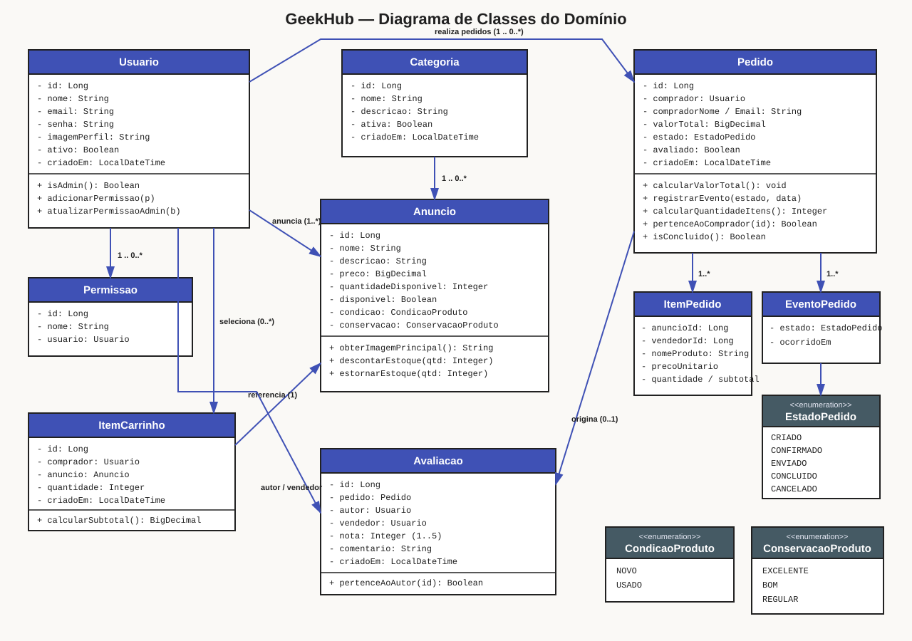
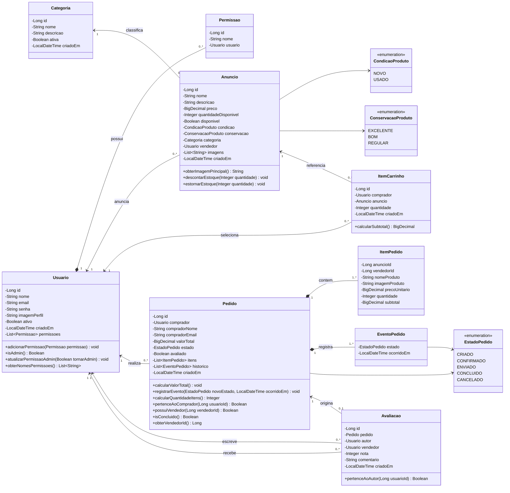

# Diagrama de Classes — GeekHub

Documentação técnica da modelagem orientada a objetos e dos relacionamentos entre as entidades de negócio do **GeekHub** (Marketplace de produtos geek e colecionáveis — Projeto Integrador UNIFIO, Grupo GuildCode).

## Modelo de Domínio (Mermaid)

## Entidades e Responsabilidades

| Classe / Entidade | Papel no Sistema | Principais Regras de Negócio |
| :--- | :--- | :--- |
| **`Usuario`** | Comprador, vendedor e administrador | Cadastro com e-mail único, edição de perfil, controle de permissões (`USUARIO`, `ADMIN`) e perfil público de vendedor. |
| **`Permissao`** | Papéis atribuídos ao usuário | Controla autorização administrativa nas rotas de categorias, usuários, listagem global de anúncios e pedidos. |
| **`Categoria`** | Classificação de colecionáveis | Permite filtragem no catálogo e gestão administrativa (cadastro, edição, ativação/desativação e remoção quando sem anúncios). |
| **`Anuncio`** | Produto ofertado por um vendedor | Controla estoque, condição (`NOVO`/`USADO`), conservação, imagens, disponibilidade e estorno/baixa de estoque nos pedidos. |
| **`ItemCarrinho`** | Carrinho de compras do comprador | Calcula subtotais por item, valida estoque disponível e mantém itens de um único vendedor por pedido. |
| **`Pedido`** | Compra formalizada com histórico | Snapshot dos itens (`ItemPedido`) e linha do tempo (`EventoPedido`) seguindo `CRIADO -> CONFIRMADO -> ENVIADO -> CONCLUIDO` ou `CANCELADO` com estorno de estoque. |
| **`Avaliacao`** | Reputação do vendedor após conclusão | Nota de 1 a 5 e comentário vinculados a um pedido concluído e único por pedido/autor. |

## Arquitetura no Frontend Angular

No aplicativo Angular (`geekhub/`), todos os componentes utilizam `standalone: false` organizados em **NgModules** com carregamento preguiçoso (*lazy loading*) por funcionalidade:

- `CatalogoModule`, `VendedoresModule`, `AutenticacaoModule`, `ContaModule`
- `AnunciosModule`, `CategoriasModule`, `CarrinhoModule`, `PedidosModule`, `DashboardModule`, `CabecalhoModule`
- A camada `DadosGeekhub` (`geekhub/src/app/api/dados-geekhub.ts`) centraliza as chamadas aos clientes HTTP (`AnuncioApi`, `CategoriaApi`, `CarrinhoApi`, `PedidoApi`, `UsuarioApi`, `AvaliacaoApi`, `AutenticacaoApi`) no modo `'auto'`, alternando automaticamente para a persistência local em `localStorage` (`App`) caso a API esteja indisponível.
