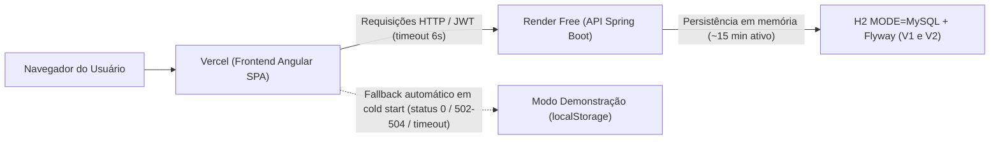

# Funcionamento do Deploy em Nuvem e Integração com a API

Este documento explica como o **GeekHub** funciona publicado em nuvem (**Vercel** + **Render Free**), por que o primeiro acesso pode exibir dados mockados locais e como ocorre a transição para a **API real (`geekhub-api`)** e a reinicialização periódica dos dados.

---

## 1. Visão Geral da Arquitetura em Nuvem

| Camada | Plataforma | URL Pública | Comportamento |
| --- | --- | --- | --- |
| **Frontend Angular (SPA)** | Vercel (`Hobby`) | <https://geekhub-site.vercel.app> | Sempre online (estático + CDN, sem hibernação) |
| **Backend REST (Spring Boot)** | Render (`Free` / Docker) | <https://geekhub-api.onrender.com> | Hiberna após **~15 min** sem requisições |
| **Documentação Interativa** | Render / Swagger UI | <https://geekhub-api.onrender.com/swagger-ui.html> | Contrato OpenAPI 3 ao vivo |
| **Health Check** | Render / Actuator | <https://geekhub-api.onrender.com/actuator/health> | Retorna `{"status":"UP"}` quando a API está ativa |

---

## 2. Primeiro Acesso, *Cold Start* e Fallback Automático

No plano gratuito do Render (**Render Free**), o container da API é colocado em hibernação após cerca de **15 minutos sem tráfego**. Quando alguém acessa o sistema pela primeira vez após esse período, o servidor leva aproximadamente **30 a 60 segundos** para iniciar a JVM, o Spring Boot e as migrations do Flyway (*cold start*).

Para garantir que o avaliador ou usuário final **nunca fique preso em uma tela de erro ou carregamento infinito**, o serviço [DadosGeekhub](../geekhub/src/app/api/dados-geekhub.ts) opera no modo **`'auto'`**:

1. Ao abrir <https://geekhub-site.vercel.app>, o frontend dispara normalmente as requisições para `https://geekhub-api.onrender.com` (o que já acorda o backend no Render em segundo plano).
2. Se a API ainda estiver inicializando e não responder em até **`6 segundos`** (`TimeoutError`, erro de conexão `status === 0` ou indisponibilidade `502`/`503`/`504`), o frontend alterna automaticamente para os **dados mockados em `localStorage`**.
3. Nesse estado, toda a aplicação continua navegável ponta a ponta (catálogo, login de demonstração, carrinho, pedidos, anúncios, categorias e dashboard), exibindo:
   - No menu lateral: **`Modo demonstração (dados locais)`**
   - No `/dashboard`: selo **`Fonte: Demonstração local`**
4. **Erros reais de regra de negócio ou permissão** devolvidos pela API (`400`, `401`, `403`, `404`, `409`, `500`) **nunca são mascarados** pelo fallback e são exibidos normalmente na tela.

---

## 3. Alternando para a API Real ao Vivo

Como o próprio primeiro acesso ao site já envia requisições ao Render e inicia o servidor, você pode passar a usar a API real logo em seguida:

1. Aguarde cerca de **30 a 60 segundos** após o primeiro acesso (opcionalmente, confira se <https://geekhub-api.onrender.com/actuator/health> já retorna `{"status":"UP"}`).
2. Recarregue a página em <https://geekhub-site.vercel.app>.
3. Se você tiver entrado no **Modo demonstração** durante o *cold start*, abra o menu lateral, clique em **Sair** e faça login novamente em `/entrar` com uma conta real da API (ex.: `admin@geekhub.com` / `123456`).
4. O frontend voltará ao estado **`'api'`**, exibindo no `/dashboard` o selo **`Fonte: geekhub-api`** e os registros diretamente do backend.

### Comparação Rápida dos Modos em Tela

| Aspecto | Modo Demonstração Local (`localStorage`) | API Real no Render (`geekhub-api`) |
| --- | --- | --- |
| **Quando ocorre** | API offline, hibernando (*cold start* > `6s`) ou inacessível | Render ativo respondendo normalmente |
| **Indicador no menu / Dashboard** | `Modo demonstração (dados locais)` / `Fonte: Demonstração local` | Sem aviso de demo / `Fonte: geekhub-api` |
| **Catálogo inicial** | `10` anúncios mockados locais | `4` anúncios ativos do seed `V2` (de `5` cadastrados) |
| **Autenticação de teste** | `demo@geekhub.com` ou `admin@geekhub.com` (`123456`) | `admin@geekhub.com`, `usuario@geekhub.com` ou `vendedor@geekhub.com` (`123456`) |
| **Onde os dados ficam** | No `localStorage` do navegador do usuário | Na memória do servidor Spring Boot (H2) enquanto ativo |

---

## 4. Ciclo de Vida e Reinicialização dos Dados no Render (`H2` + `Flyway`)

No ambiente publicado no Render, o backend executa com o profile **`render`**, utilizando banco **H2 em memória em modo de compatibilidade MySQL** (`MODE=MySQL;DATABASE_TO_LOWER=TRUE;DB_CLOSE_DELAY=-1`), validação de schema do Hibernate (`ddl-auto=validate`) e **Flyway** habilitado:

- **Enquanto a API estiver ativa (até ~15 minutos sem novas requisições)**:
  - Toda operação realizada no site ou via Swagger/Postman (cadastro de usuários, criação/edição/exclusão de anúncios e categorias, carrinho, pedidos, avanços de estado, cancelamentos e avaliações) fica salva em memória e é refletida imediatamente para todos os usuários.
- **Quando a API hiberna e reinicia (~15+ minutos sem uso)**:
  - Como o banco está na memória do container e não em um servidor MySQL externo pago, o container sobe limpo e o **Flyway executa novamente as migrations `V1` e `V2`** automaticamente.
  - Isso restaura a estrutura validada das tabelas e a massa inicial padrão de usuários, categorias, anúncios, pedidos e avaliações — evitando acúmulo de lixo de testes e garantindo sempre um ponto de partida determinístico para novas avaliações.

> **Observação sobre ambiente local**: rodando localmente via **Dev Container** ou com **MySQL 8** padrão (`application.properties`), a API utiliza as mesmas migrations `V1` e `V2` diretamente no MySQL.

---

## 5. Pipeline de Deploy Automático (CI/CD)

- **Frontend (`geekhub-site`)**: publicado via GitHub Actions ([.github/workflows/deploy-vercel.yml](../.github/workflows/deploy-vercel.yml)) a cada push na branch `main` (diretório `geekhub/`), executando a suíte completa de testes Vitest antes do deploy em produção na Vercel e registrando o ambiente `production` na seção **Deployments** do GitHub.
- **Backend (`geekhub-api`)**: publicado automaticamente no Render a cada push na `main` via `Dockerfile` multi-stage e `render.yaml`.
